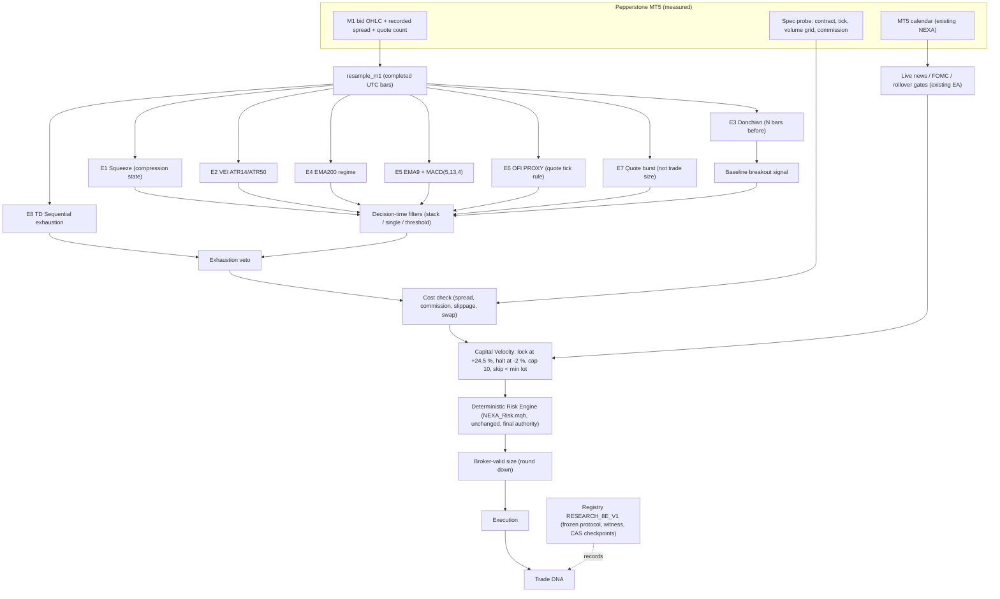

# NEXA 8-engine deep research (2026-10-01): definitions, data constraints, prior evidence, design

**Scope.** This is research only.
- It is separate from V2: V2 stays FROZEN, **not opened** and **not evaluated**, at anchor `6090be68…`.
- It is not deployed and does not touch the live EA.
- The measured results are in `NEXA_8_ENGINE_RESULTS.md`.

## 1. Repository placement (step 1–2: inspection and architecture mapping)
| Component | Location | Reason |
|---|---|---|
| Engine features | `research/nexa_8e_engines.py` | The Python research tier owns features until they are validated. MQL5 porting happens only after approval (MQL5 rule). |
| Harness (signals, simulation, metrics) | `research/nexa_8e_research.py` | It reuses the audited `nexa_execution` (bar-mode fills, stop-first ambiguity, gap fills) unchanged. |
| Cost and sizing | `research/nexa_8e_costs.py` | It is driven only by the broker spec captured by `NEXA_SpecProbe.mq5`. |
| Capital Velocity | `research/nexa_8e_capital.py`, `research/nexa_8e_feasibility.py` | — |
| Protocol, registry, runner | `research/protocols_8e.py`, `research/registry_8e/`, `research/run_8e.py`, `research/analyze_8e.py` | `nexa_registry2` machinery is reused unchanged in a **separate root**. |
| Tests | `research/test_nexa_8_engines.py`, `research/test_nexa_capital_velocity.py`, `research/test_nexa_pepperstone_costs.py` | The repository convention is `research/test_*.py`; there is no top-level `tests/` directory. |

Modules mapped to the requested names:
- `NEXA_SqueezeEngine` → `squeeze`
- `NEXA_VEIEngine` → `vei`
- `NEXA_DonchianEngine` → `donchian`
- `NEXA_TrendEngine` → `trend`
- `NEXA_MomentumEngine` → `momentum`
- `NEXA_OrderFlowEngine` → `ofi_proxy`
- `NEXA_BigTradeEngine` → `quote_burst`
- `NEXA_TDSequentialEngine` → `td_sequential` + `td_exhaustion`
- `NEXA_CapitalVelocity` → `nexa_8e_capital`
- `NEXA_BrokerCostEngine` and `NEXA_DynamicPositionSizer` → `nexa_8e_costs`

## 2. What each engine is, and is not
1. **Bollinger Squeeze.** A volatility-compression state: Bollinger Bands inside Keltner Channels, a construction popularised by practitioners in the 2000s. Compression is a **state**, not a direction. A release ("fire") says that volatility is expanding, not which way.
   - **Baseline parameters:** BB(20, 2σ) and KC(20, 1.5 × ATR20).
   - **Not tested here:** alternative families such as KC multipliers 1.0 / 2.0 or BB 2.5σ (see the Not-run list in `NEXA_8_ENGINE_EXPERIMENT_MATRIX.md`).
2. **VEI = ATR14/ATR50.** Short-term over long-term volatility. VEI > 1 means recent ranges are wider than the longer norm. It is a **relative-volatility** measure and is scale-free across symbols.
   - "Volume must spike" cannot be tested with real volume. The only activity measure available is the quote-update count (`tickvol_z`).
3. **Donchian breakout.** The N-bar high/low excluding the current bar, as in the 1980s trend-following systems.
   - **NEXA's own prior evidence:** the factory's Donchian/TrendLock breakouts on Pepperstone XAUUSD H1 did **not** beat random entries; gold's drift explained the gains.
4. **EMA200.** A slow trend/regime feature. It does **not** measure institutional order flow, and nothing in the data supports that claim.
5. **EMA9 + MACD(5,13,4).** Fast momentum alignment. These are very short spans: MACD(5,13,4) reacts within a few bars and is highly collinear with the breakout bar itself. **Redundancy is expected.**
6. **Order Flow Imbalance.** **Not measurable** at Pepperstone. Ticks carry only bid/ask change bits: 0 of 10.8 million XAUUSD ticks have LAST, VOLUME, BUY or SELL bits (`runs_8e/tick_data_audit.json`).
   - **The implemented proxy:** a 1-minute tick-rule split of quote counts. It correlates **0.25** with tick-level quote imbalance.
   - **The proposed "300 %" threshold:** tick-level quote imbalance **never** reaches 3.0 (median 1.004, p95 1.12). The bar proxy reaches it 17 % of the time only because of how the proxy is built.
7. **"Big Trades".** **Not measurable**: an OTC CFD feed has no trade sizes. The implemented proxy is abnormal **quote activity**: quote count relative to its median, a trailing percentile, and the maximum 1-minute burst. `tick_volume` correlates 0.947 with the actual tick count, so it is a quote count, not volume.
8. **TD Sequential.** DeMark's setup (9) and countdown (13) count exhaustion in a run of closes. The implemented version is the classic setup with price flip and the classic countdown (close ≤ low[2] / ≥ high[2]), with cancellation by an opposite setup. TDST, perfection and recycling are **not** implemented. TD is used as an **exhaustion feature or veto**, not as a reversal predictor.

## 3. Data-truth constraints (step 6)
- **What exists:**
  - M1 bid OHLC with recorded spread and quote counts: 2017–2026 for EURUSD, GBPUSD, USDJPY, XAUUSD, XAGUSD;
  - quote ticks for 21 days.
- **What does not exist:**
  - NAS100 history; the research is BLOCKED until a data decision;
  - real volume, aggressor side, depth of market, trade size.
- **The recorded M1 spread is a minimum, not a typical spread.** EURUSD and GBPUSD record **0 points in the median minute**, while the live probe sampled 2–3 points. **FX backtest costs are therefore understated**, and the spread-stress multipliers cannot fix a zero. XAUUSD records a 12-point median and is usable. A separate spread-floor sensitivity is reported for FX in the results.
- **No historical window is unseen.** The 2017–2026 data was used by earlier NEXA work, so VAL evidence here is in-sample-like. The only clean test is the prospective OOS (2026-10-12 → 2027-04-12).

## 4. Overfitting control
**Staged and frozen.**
- Definitions, thresholds, the trial universe (2,160 trials), periods, costs and the selection rule were all frozen before any VAL data was read.
- Every trial is counted, and failed configurations are kept.
- DSR uses 2,160 + 1,848 trials. PBO is computed per selected group.
- There is one VAL query per trial, and selection is sealed before the prospective OOS.

## 5. Architecture diagram

