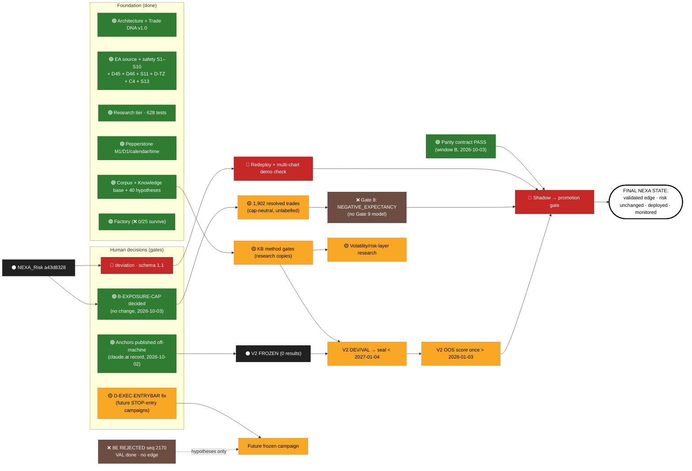

# NEXA MASTER ROADMAP: visual status chart (2026-10-02, updated after the 8E close)

Built from repository evidence only. Full evidence per item: `NEXA_MASTER_PROJECT_STATUS.md` and `NEXA_MASTER_PROJECT_STATUS.json`.

**Legend:** 🟢 COMPLETE · 🔵 IN PROGRESS · 🟡 PENDING · 🔴 BLOCKED · ⚫ FROZEN · ❌ REJECTED/FAILED · ⚪ NOT FOUND

---

## 1. One-screen chart: PHASE / COMPONENT → STATUS → DEPENDENCIES → NEXT ACTION → FINAL NEXA STATE

| Phase / component | Status | Depends on | Next action | Final NEXA state |
|---|---|---|---|---|
| Core architecture (MQL5 ⇄ Python, Trade DNA v1.0) | 🟢 | — | Decide schema v1.1 (proposed) | Stable contract, versioned |
| Agent-Lab Astra/Opus orchestrator | 🟡 | Human choice | None required (no usable output so far) | Optional dev tooling |
| MQL5 EA source (safety S1–S10, D45, D46, S11, D-TZ, C4, S13) | 🟢 | — | — | Verified source |
| EA deployment to terminal | 🔴 | Approval (S11, D-TZ, C4 and S13 fixed; exposure cap decided: unchanged) | Do not deploy yet (stale 09-27 build live) | Verified build deployed + demo forward check |
| Risk Engine `NEXA_Risk.mqh` a43d8328 (S11 + C4 approved 2026-10-03) | ⚫ | Human authorisation for any change | — | Unchanged hard limits |
| S11 exposure fail-open | 🟢 | — | Fixed 2026-10-03 (approved option A, D47; not deployed) | Fail-closed |
| B-EXPOSURE-CAP (0.02 lots) | 🟢 | — | Decided 2026-10-03: no change (cap-neutral Gate 8 NEGATIVE_EXPECTANCY) | Production cap unchanged unless a validated edge appears |
| 2 % daily-loss semantics (C4) | 🟢 | — | Fixed 2026-10-03 (approved option B: pre-trade budget, trigger kept; D49; not deployed) | Defined, tested |
| Intelligence Engine (ONNX seam, veto-only) | 🟢 | — | — | Model plugged in after validation |
| Trained model / calibration | 🔴 | A rule set with an edge (none) | — | Calibrated veto-only model (optional) |
| Research Engine (Python tier, 628 tests) | 🟢 | — | — | Maintained |
| Live execution engine | 🟢 | — | Optional OrderCheck / OnTester | Forward-checked on demo |
| Deviation policy (S14) | 🟡 | Human; fill logs | Decide | Evidence-based deviation |
| Position management D45 (partial / time exit after BE) | 🟢 | — | Deploys with the next approved build (fixed + verified 2026-10-03, not deployed) | Specified exits work live |
| Stale-bar guard D46 (no trade on a bar evaluated > 6 h late) | 🟢 | — | Deploys with the next approved build (fixed + verified 2026-10-03, not deployed) | No weekend / holiday stale entries |
| Execution simulator D-EXEC-ENTRYBAR | 🟡 | Human; pinned in V2 | Fix before any future STOP-entry campaign is frozen (8E closed with it disclosed) | Corrected (V2 unaffected) |
| Trade DNA v1.0 + real DNA (3.93 M rows) | 🟢 | — | — | — |
| Labels at scale | 🟡 | Research-phase need | Label the 1,902 cap-neutral trades only if needed | ≥ 200 resolved trades (exist, research config) |
| Feature parity | 🟢 | — | Window-B contract PASS 2026-10-03 (4 symbols, 0 mismatches, 47 reviewed ties); re-run 2026-10-04 with 44 features (f29 now compared) | Parity PASS |
| Parity tolerance contract | 🟢 | — | Decided 2026-10-03 (option A: journal-quantisation tolerance + reviewed tie register) | Achievable contract |
| Strategy Factory | 🟢 | — | — | Proposes only via frozen campaigns |
| Factory results (0/25 survive) | ❌ | — | No re-tuning | — |
| Validation code (Gate 8/9/12) | 🟢 | — | — | — |
| Validation applied to NEXA | ❌ | — | Gate 8 NEGATIVE_EXPECTANCY (2026-10-03); no Gate 9/12 on this rule set | Gates passed (not met) |
| Data: Pepperstone M1/D1/calendar/time | 🟢 | — | — | — |
| Data: ticks (21 days only) | 🟡 | Approval to run the logger; disk | Start post-freeze tick logging | Months of ticks |
| Data: NAS100 | 🔴 | Data decision | Decide | — |
| Data: depth / volume / swaps / 2nd feed | 🔴 | Not available at broker | — | DATA-LIMITED (accepted) |
| MT5 / Pepperstone integration | 🟢 | — | — | — |
| MCP (read-only) | 🟢 | — | Keep read-only | — |
| V2 (PHASE3_SIX_FAMILIES_V2) | ⚫ | Explicit "OPEN V2" (checkpoint from the off-machine record) | Decide opening | OOS verdict after 2028-01-03 |
| V2 F4 / F6 | 🔴 | Second feed / order flow | — | — |
| V1 campaign | ❌ | — | Never open | — |
| Superseded / accidental freezes | ⚫ | — | Never open | — |
| 8E (RESEARCH_8E_V1) | ❌ | — | None: **REJECTED** (terminal) at seq 2170 `9f7249a2…`, 2026-10-02 | Closed: no edge (VAL done, no pick passes DSR) |
| 8E DEV verdicts | ❌ | — | — | — |
| 8E NAS100 | ❌ | — | Closed with 8E, never evaluated | Any NAS100 test needs a new frozen campaign |
| +24.5 %/day objective | ❌ | — | Drop as an objective | Constraint math only |
| Capital-velocity simulator | 🟢 | — | — | Research tool |
| Research corpus (39 files) | 🟢 | — | — | — |
| Knowledge base | 🟢 | — | — | — |
| 205-indicator library | ⚪ | User to supply its location | — | — |
| Math KB / Stat KB | 🟢 | — | — | — |
| 40 research hypotheses | 🟡 | Research-phase approval | Method gates first | Tested under frozen protocols |
| Testing infrastructure | 🟢 | — | — | — |
| Production readiness | 🔴 | Validated edge, all decisions | — | Shadow → promotion gate |
| D-TZ (DST-aware clock) | 🟢 | — | Fixed 2026-10-03 (approved option A, D48; not deployed) | Resolved |
| S13 (time-aligned USD composite) | 🟢 | — | Fixed 2026-10-04 (approved option B, D50; trading unchanged; not deployed) | Resolved |
| Multi-instance / requote paths | 🟡 | Deployment | Demo forward check | Verified |
| Off-machine anchors | 🟢 | — | Published 2026-10-02 ([NEXA Registry Checkpoints](https://claude.ai/artifact/6o1hnw9docUUW48gZ5Wf59)); republish after every new V2 event | R1 residual closed |
| Documentation drift | 🟡 | Approval | Fix 2 non-pinned docs | Consistent |
| M1 gaps in DEV | 🟡 | — | Keep documented | — |

---

## 2. Dependency flow (Mermaid)



---

## 3. Swim-lane timeline (calendar-fixed dates come from frozen protocols)

| Date | Event | Source |
|---|---|---|
| 2026-10-02 | **8E closed.** VAL (2,160) and pinned selection (6) sealed, then CAMPAIGN_REJECTED at seq 2170 `9f7249a2…` | `registry_8e/ledger.jsonl` |
| ~~2026-10-12T00:00Z~~ | 8E OOS start. **No longer relevant:** 8E is REJECTED | `protocols_8e.py` |
| 2027-01-04T00:00Z | V2 selection must be sealed before this; V2 OOS window opens | `OOS_DETERMINATION_V2.md`; `V2_OPENING_CHECKLIST.md` |
| ~~2027-04-12T00:00Z~~ | 8E OOS window end (moot: 8E REJECTED, and no pinned OOS scoring path existed) | `protocols_8e.py` |
| 2027-12-08 | Last FOMC date in the EA table | `NEXA_FOMC.mqh` (PROGRESS 09-27) |
| 2028-01-03T00:00Z | V2 OOS window ends; single OOS scoring allowed after this | `OOS_DETERMINATION_V2.md` |

---

## 4. Status totals (53 items)

```
🟢 COMPLETE     ██████████████████████████  26
🔴 BLOCKED      ██████                       6
🟡 PENDING      █████████                    9
❌ REJECTED     ███████                      7
⚫ FROZEN       ████                         4
⚪ NOT FOUND    █                            1
🔵 IN PROGRESS                               0
```

**Reading the chart:**
- Engineering and knowledge foundations are done.
- The cap-neutral campaign answered the former root question: **NEXA's rule set has no edge** (Gate 8 NEGATIVE_EXPECTANCY, 2026-10-03). Production readiness is now blocked by the absence of an edge, not by the exposure cap, which stays unchanged.
- **8E is closed** (REJECTED 2026-10-02, no edge). The next calendar-fixed deadline is **2027-01-04** (V2 selection, only if V2 is opened).
